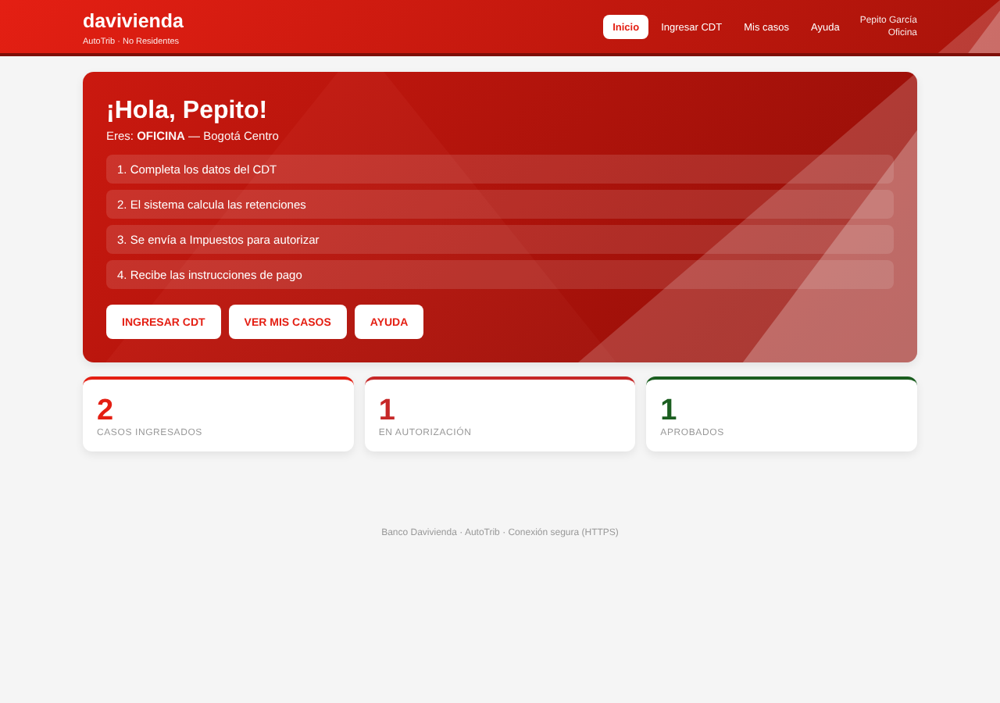
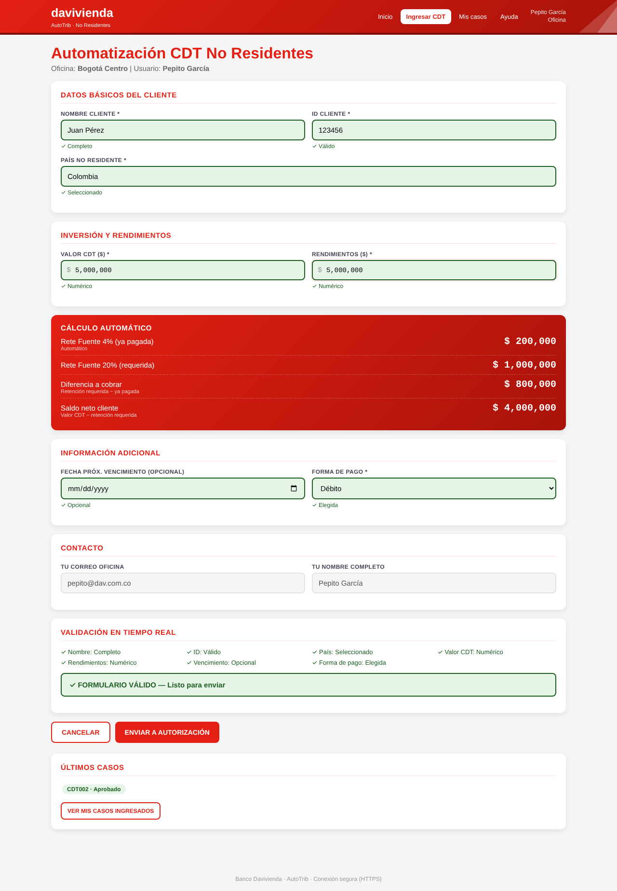
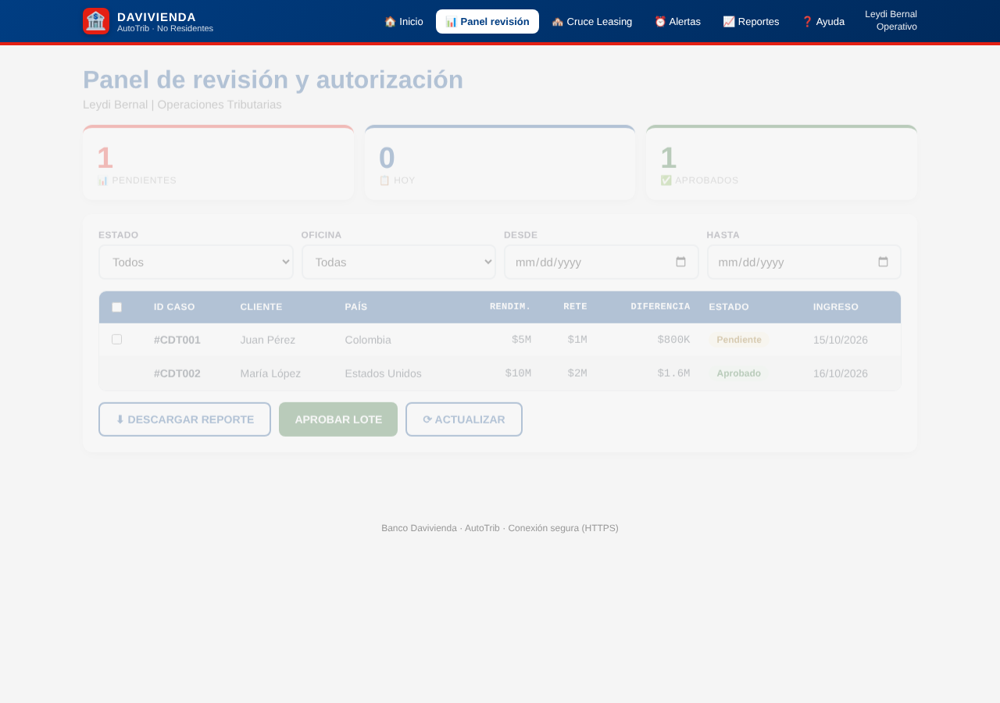
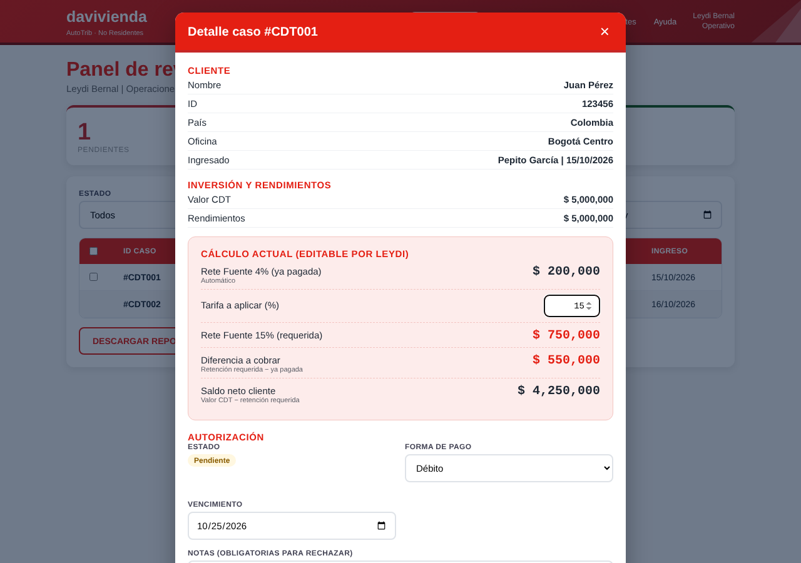

# Cómo entrar

Abre el enlace que te compartió el administrador. El sistema identifica tu correo corporativo automáticamente; no hay usuario ni contraseña adicionales. Si es tu primera vez, entras automáticamente con el rol **Oficina**. Si ves **Acceso denegado**, tu acceso fue bloqueado: contacta al administrador.

# Roles

- **Oficina** (por defecto): ingresa CDT y ve solo sus casos.
- **Operativo** (Leydi y administradores): aprueba, ajusta tarifa, alertas y reportes.
- **Contabilidad**: solo lectura de casos aprobados y pagados.

El administrador cambia el rol en la hoja ACCESOS; la hoja ROLES explica cada uno.

## Si eres Oficina

1. Pulsa **Ingresar CDT**.
2. Completa nombre, ID, país (escribe para buscar), valor del CDT y rendimientos. Los montos se formatean solos.
3. El cuadro azul calcula en vivo: Rete 4 % ya pagada, Rete 20 % requerida, diferencia a cobrar y saldo neto.
4. Elige la forma de pago y, si lo conoces, la fecha de vencimiento.
5. Cada campo cambia de color: **rojo** falta o inválido, **amarillo** incompleto, **verde** correcto. El botón **Enviar a autorización** se habilita cuando todo está verde.

## Después de enviar

1. Recibes un correo de confirmación y Leydi recibe el aviso.
2. Cuando Leydi aprueba, te llega el correo **Caso aprobado - Instrucciones de pago** con un botón a la guía paso a paso (Débito, Efectivo o Transferencia).
3. Marca cada paso y pulsa **Marcar como completado**. Contabilidad es notificada.
4. 5 días antes del vencimiento recibes una alerta: puedes **Editar datos** (fecha, forma de pago, notas) o **Confirmar vencimiento**.
5. En **Mis casos** consultas el estado de todos tus casos.

# Si eres Operativo (Leydi)

1. **Panel revisión**: filtra por estado, oficina o fechas. Toca un caso para abrir el detalle.

2. En el detalle puedes cambiar la **tarifa %** (0 a 100); los valores se recalculan al instante. También puedes ajustar forma de pago, vencimiento y notas.

3. **Aprobar** envía las instrucciones a la oficina. **Rechazar** exige escribir el motivo. Ambas acciones piden confirmación y quedan en la auditoría.
4. **Aprobar lote**: marca varios casos pendientes y aprueba con sus condiciones actuales.
5. **Alertas**: vencimientos próximos y su estado. **Reportes**: resumen y descarga a Excel (CSV) o PDF (Imprimir).

# Si eres Contabilidad

Ves únicamente los casos aprobados y pagados, con filtros y descarga de reporte, y recibes un correo cuando un caso queda listo para registro.

# Preguntas frecuentes

- **¿Puedo editar un caso ya enviado?** No. Solo Operativo ajusta casos pendientes; la oficina puede cambiar fecha, forma de pago y notas desde la alerta de vencimiento.
- **¿Se pueden borrar casos?** No. Los casos solo cambian de estado y todo cambio queda en la auditoría.
- **¿Funciona en el celular?** Sí. El formulario y el panel están adaptados a pantallas pequeñas.
